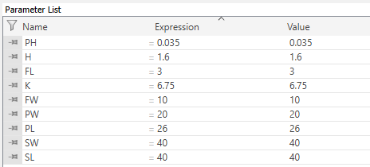
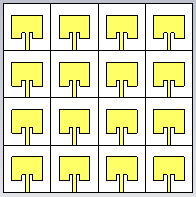
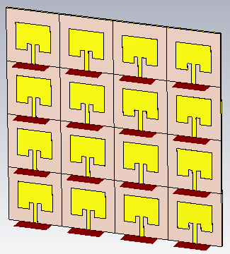
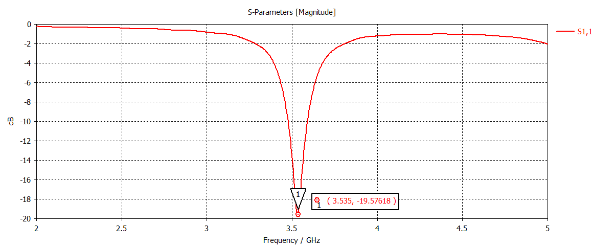
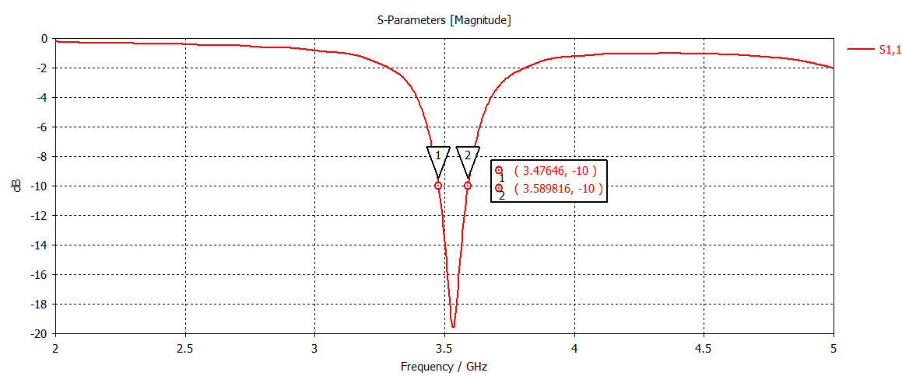
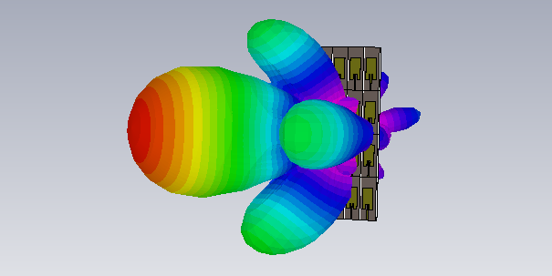
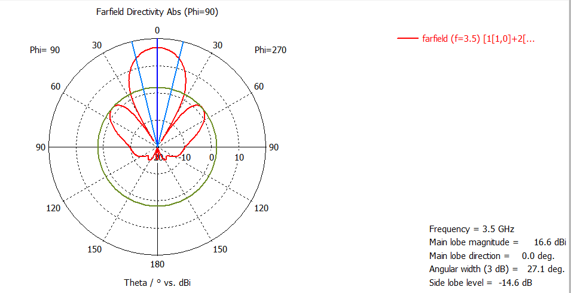

# Réseau d'antennes patch 4×4 à 3,5 GHz (bande n78), simulation sous CST Studio Suite

Projet de fin d'études, Master en systèmes embarqués, réseaux et télécommunications (FST Mohammedia).
Ce dépôt présente la conception et les résultats de simulation d'un réseau planaire de 16 patchs microruban.

## Cahier des charges
- Réseau planaire 4×4 (16 patchs rectangulaires), substrat FR-4 (εr = 4,3, épaisseur 1,6 mm)
- Fréquence centrale : 3,5 GHz (bande 5G n78)
- Adaptation : S11 < −10 dB (VSWR < 2)
- Lobe principal en broadside, polarisation linéaire
- Gain et directivité maximisés

## Conception
## Conception
L'élément unitaire est un patch rectangulaire de 26 mm × 20 mm sur une cellule de substrat de 40 mm × 40 mm (FR-4, 1,6 mm). La cellule est reproduite 16 fois pour former le réseau 4×4.

Chaque patch est alimenté par une ligne microruban adaptée à 50 Ω. Plan de masse en face inférieure.

<table>
<tr>
<td align="center"> <em>Paramètres CST de la cellule</em></td>
<td align="center"> <em>Disposition 4×4 (vue de dessus)</em></td>
<td align="center"> <em>Modèle 3D sous CST</em></td>
</tr>
</table>

## Résultats de simulation (CST Studio Suite)
| Paramètre | Valeur |
|---|---|
| Fréquence de résonance | 3,535 GHz |
| S11 minimum | −19,6 dB |
| Bande passante (S11 < −10 dB) | ≈ 114 MHz (3,476 à 3,590 GHz) |
| VSWR minimum | ≈ 1,27 |
| Directivité | 16,58 dBi |
| Gain | 13,20 dBi |
| Efficacité de rayonnement | −3,38 dB (≈ 46 %) |
| Efficacité totale | −3,55 dB (≈ 44 %) |
| Ouverture à −3 dB (plan vertical) | 27,1° |
| Lobes secondaires (plan vertical) | −14,6 dB |

 <em>S11 : minimum de −19,6 dB à 3,535 GHz</em>

 

 <em>Bande passante à −10 dB : 3,476 à 3,590 GHz (≈ 114 MHz)</em>

 

 <em>VSWR : minimum ≈ 1,27 à 3,525 GHz</em>

 

 <em>Diagramme de rayonnement 3D à 3,5 GHz (lobe principal en broadside)</em>

 

 <em>Coupe θ = 90° (plan de l’antenne, loin du lobe principal)</em>

 

 <em>Coupe φ = 90° : ouverture à −3 dB de 27,1°, lobes secondaires à −14,6 dB</em>

Autres captures dans `results/` : directivité, gain, tableau d'efficacité.

## Limites et prochaines étapes
- Travail réalisé uniquement en simulation, sans fabrication ni mesure à ce stade.
- L'efficacité (≈ 46 %) est limitée par les pertes du FR-4 : test d'un substrat à faibles pertes (Rogers) prévu.
- Chaque patch a sa propre ligne d'alimentation : conception d'un réseau d'alimentation commun (corporate feed) prévue.

## Contact
Oualid Bargach, [LinkedIn](https://www.linkedin.com/in/oualid-bargach)
