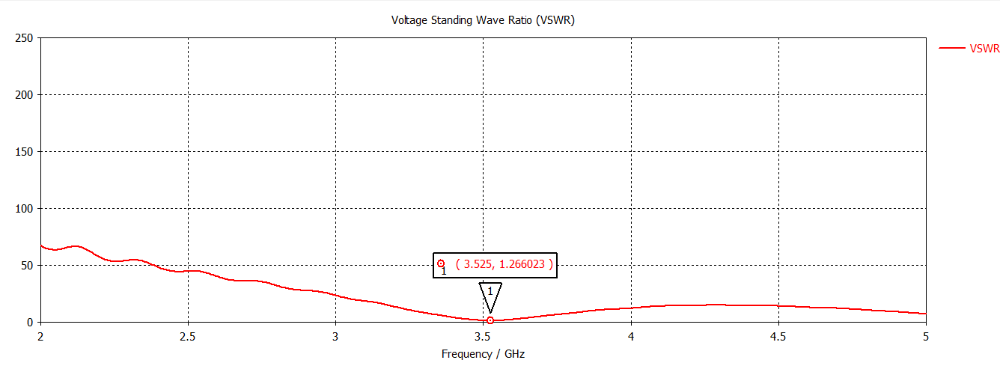
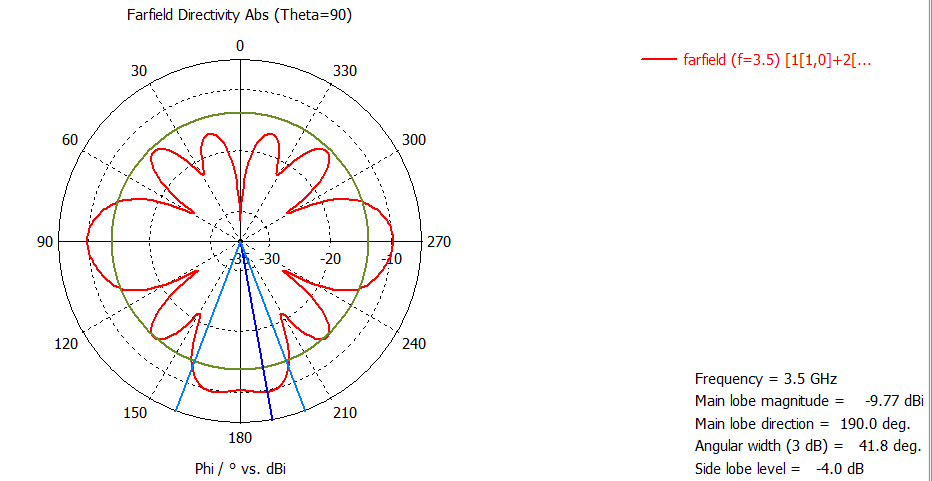

# Réseau d'antennes patch 4×4 à 3,5 GHz (bande n78), simulation sous CST Studio Suite

Projet de fin d'études, Master en systèmes embarqués, réseaux et télécommunications (FST Mohammedia).
Ce dépôt présente la conception et les résultats de simulation d'un réseau planaire de 16 patchs microruban.

## Cahier des charges
- Réseau planaire 4×4 (16 patchs rectangulaires), substrat FR-4 (εr = 4,3, épaisseur 1,6 mm)
- Fréquence centrale : 3,5 GHz (bande 5G n78)
- Adaptation : S11 < −10 dB (VSWR < 2)
- Lobe principal en broadside, polarisation linéaire
- Gain et directivité maximisés

## Conception
Chaque patch est alimenté par une ligne microruban de 50 Ω (largeur 3 mm). Plan de masse continu en face inférieure.

## Résultats de simulation (CST Studio Suite)
| Paramètre | Valeur |
|---|---|
| Fréquence de résonance | 3,535 GHz |
| S11 minimum | −19,6 dB |
| Bande passante (S11 < −10 dB) | ≈ 114 MHz (3,476 à 3,590 GHz) |
| VSWR minimum | ≈ 1,27 |
| Directivité | 16,58 dBi |
| Gain | 13,20 dBi |
| Efficacité de rayonnement | −3,38 dB (≈ 46 %) |
| Efficacité totale | −3,55 dB (≈ 44 %) |
| Ouverture à −3 dB (plan vertical) | 27,1° |
| Lobes secondaires (plan vertical) | −14,6 dB |

Autres captures dans `results/` : directivité, gain, tableau d'efficacité.

## Limites et prochaines étapes
- Travail réalisé uniquement en simulation, sans fabrication ni mesure à ce stade.
- L'efficacité (≈ 46 %) est limitée par les pertes du FR-4 : test d'un substrat à faibles pertes (Rogers) prévu.
- Chaque patch a sa propre ligne d'alimentation : conception d'un réseau d'alimentation commun (corporate feed) prévue.
- Fabrication et mesure au VNA prévues pour comparer simulation et mesure.

## Contact
Oualid Bargach, [LinkedIn](https://www.linkedin.com/in/oualid-bargach)
